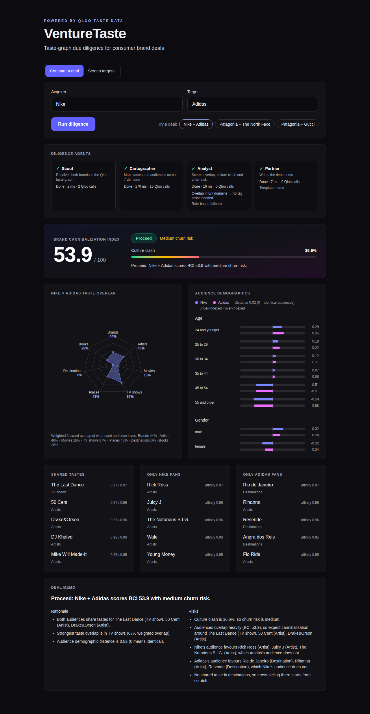
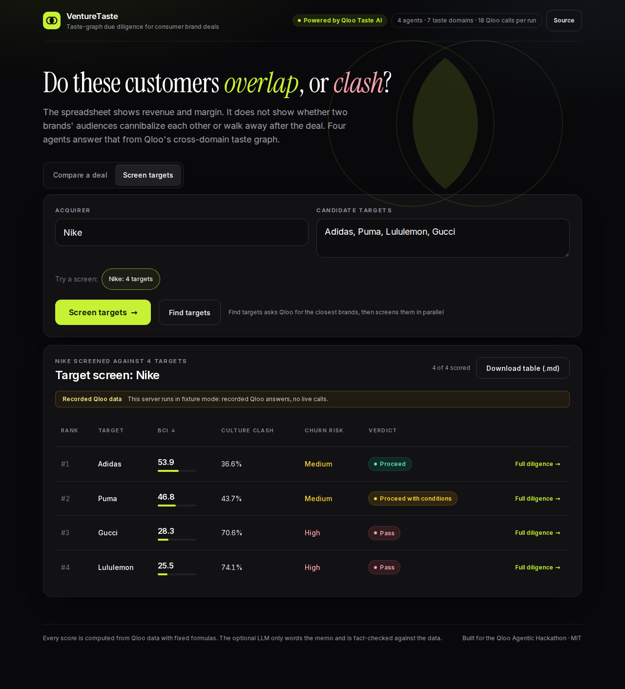

# VentureTaste

An autonomous 4-agent M&A and venture diligence pipeline for consumer brand acquisitions. Give it an acquirer and a target; it pulls both brands' taste profiles from Qloo's cross-domain taste graph and deterministically scores brand synergy, customer overlap (cannibalization) and cultural churn risk, then writes a deal memo with a verdict.

**Live demo: https://venturetaste.5-78-152-178.sslip.io**

Source: https://github.com/chrisbuildsonline/venturetaste. License: MIT, see [LICENSE](LICENSE).

When the server has no valid Qloo key, preset brand pairs replay recorded Qloo answers, and the UI labels those runs "Recorded Qloo data".

The hosted demo has a valid Qloo key and calls live Qloo (18 calls per run, answers cached on disk, no recorded banner). Captured 2026-10-27:



## What it does

Deal teams can see revenue and margin for a consumer brand, but not whether the buyer's and the target's customers overlap (cannibalization) or clash (churn after the deal). VentureTaste answers that with Qloo's cross-domain taste graph: it compares what each brand's audience loves across brands, artists, movies, TV shows, places, destinations and books, plus age and gender. Four agents run the diligence. Scout resolves both brands in Qloo, Cartographer pulls their taste and demographic profiles, Analyst scores overlap and culture clash with fixed formulas, and Partner writes a deal memo with a verdict (Proceed, Proceed with conditions, Pass). "Find targets" screens one acquirer against up to 5 candidates, so a team can rank possible deals before running full diligence. The buyers are corporate development teams, consumer-brand investors and M&A advisors (see [Who pays](#who-pays)).

Built for the [Qloo Agentic Hackathon](https://qloo.devpost.com/). Submissions close 2026-10-30.


Stack: Python, FastAPI, LangGraph, Pydantic, Qloo Taste AI API, Next.js (static export), Tailwind, Recharts. Every number comes from Qloo data and fixed formulas, so the scores are reproducible. An optional local LLM plans and writes the memo text (see [Optional LLM agent](#optional-llm-agent)).

## Who pays

The buyer is the team that signs consumer-brand deals: corporate development teams, PE and VC investors in consumer brands, and M&A advisors. Their spreadsheets cover revenue and margin but not whether two customer bases overlap (cannibalization) or clash (churn after the deal). Pricing idea: per seat as SaaS for deal teams, or per diligence report for advisors who run a few deals a year. Target screening (one acquirer against up to 5 candidates) is the sourcing-stage hook.

## Why it needs Qloo

The pipeline is built on Qloo's cross-domain taste graph. A brand maps to the things its audience loves in seven domains (brand, artist, movie, tv_show, place, destination, book) plus its age and gender skew. Comparing two brands across those domains is what makes "do these customers overlap, or clash?" answerable. Without Qloo there is no data to compare.

Endpoints used (`api/qloo.py`, header `X-Api-Key`):

- `GET /search` with `query=<brand>` and `types=urn:entity:brand` resolves a brand name to a Qloo entity.
- `GET /v2/insights` with `filter.type=urn:entity:<domain>`, `signal.interests.entities=<entity id>` and `take=50` (the most Qloo allows) returns the entities with the highest affinity for that brand, one call per domain.
- `GET /v2/insights` with `filter.type=urn:demographics` and `signal.interests.entities=<entity id>` returns the brand's age and gender affinities.

Responses are cached on disk (`.cache/qloo`), and HTTP 429 is retried with backoff.

## The four agents

`api/pipeline.py` runs them as a LangGraph `StateGraph`. Each agent records its name, status, duration and Qloo call count in a `trace`.

1. **Scout** resolves both brand names to Qloo entities (2 calls).
2. **Cartographer** fetches insights for all 7 domains plus demographics for both brands (16 calls, in parallel threads). 18 Qloo calls per run with the two searches.
3. **Analyst** scores the pair with `api/scoring.py` (pure code) and then decides whether to probe tags. The optional LLM makes that call; without it the rule is: if at least 4 of the 7 domains have zero taste overlap, it asks Qloo for each brand's tag affinities (2 extra calls) and reports the top 5 tags both audiences share as "bridging tastes", ranked by the weaker of the two affinities. Bridges are evidence only and never change the BCI, clash score or verdict. Its trace item carries a `decision` string saying which way it went.
4. **Partner** writes the deal memo: a verdict (`Proceed`, `Proceed with conditions`, `Pass`, always computed from the scores), and rationale and risks that name real Qloo entities from the data. The optional LLM writes the rationale and risks; otherwise a template does.

### Optional LLM agent

The Analyst's tag-probe decision and the Partner's memo text can come from an LLM, by default a local [Ollama](https://ollama.com) model (`ollama pull qwen2.5:7b`; `bun run llm:up` starts the service). It is never required and never touches a number:

- **Scores, verdict and headline stay deterministic.** The LLM only chooses whether to spend the two tag calls and words the rationale and risks.
- **Every cited entity is checked.** The LLM returns each memo line with the entity names it cites. A cite must match (case-insensitively) an entity Qloo returned for this pair (the two brands, shared tastes, each side's distinctive tastes, bridging tags) and appear in the line's text; a line citing nothing must quote a number. One bad cite rejects the whole LLM memo.
- **Cold start.** Ollama unloads an idle model; the first run after that can hit the 30 s cut-off while the weights load and falls back to the template. Set `OLLAMA_KEEP_ALIVE` to keep it loaded.
- **Fallback.** If the LLM is off, unreachable (a refused connection fails in about a second; replies are cut off after 30 s), answers bad JSON or fails the check, the rule decides and the template writes the memo. Each trace item says who decided (`planner`: `llm`, `rule` or `template`, plus `model` or `fallback` with the reason), the UI shows "Decided by qwen2.5:7b" or "Rule-based fallback", and "Memo by qwen2.5:7b" or "Template memo", and `memo.author` is the model or `template`.

| Variable | Default | What it does |
| --- | --- | --- |
| `VENTURETASTE_LLM` | on | `off` disables the LLM (the e2e tests and the Docker image smoke test run this way or with no LLM present) |
| `VENTURETASTE_LLM_URL` | `http://localhost:11434/v1` | any OpenAI-compatible base URL |
| `VENTURETASTE_LLM_MODEL` | `qwen2.5:7b` | model name |
| `VENTURETASTE_LLM_API_KEY` | none | sent as a Bearer token; lets you use a paid provider, never required |

## API

`POST /api/diligence` runs the pipeline and returns one JSON report: resolved brands, scores, `domain_overlap` for all 7 domains (no data = 0), top shared and clashing tastes, demographics for both brands, `bridges` (`[{id, name, affinity_acquirer, affinity_target}]`, empty when none) and `probed_tags` (whether the Analyst probed Qloo tags), the memo, and the per-agent `trace` (the Analyst item also has a `decision`).

```
curl -s -X POST http://127.0.0.1:8765/api/diligence \
  -H 'Content-Type: application/json' \
  -d '{"acquirer": "Nike", "target": "Adidas"}'
```

`recorded` is `{"reason": "..."}` when the answers are recorded Qloo data instead of live calls, and absent on live runs. It is set when `VENTURETASTE_FIXTURES=1`, and when the server has no `QLOO_API_KEY` or Qloo rejects the key (HTTP 401 or 403) and both brands are preset brands (the ones in `api/fixtures.py`); the run is then repeated on the recorded answers. The stream does the same: no `error` event, and the final `result` carries `recorded`. Other brands, and every other Qloo failure (timeouts, 429, 5xx), keep the errors below.

Errors are `{"detail": "..."}` with: 422 for a bad body, an unknown brand, a brand with no taste data, or the same brand twice; 503 when `QLOO_API_KEY` is missing; 502 when Qloo fails or returns something unparseable.

`POST /api/diligence/stream` takes the same body and returns server-sent events (`text/event-stream`, with `Cache-Control: no-cache` and `X-Accel-Buffering: no`):

- `event: agent` with `{"agent": "Scout", "status": "running"}` when an agent starts, and `{"agent": "Scout", "status": "ok", "ms": 4, "qloo_calls": 2}` when it finishes. Agents come in order: Scout, Cartographer, Analyst, Partner.
- `event: result` with the same report `POST /api/diligence` returns. It is the last event of a good run.
- `event: error` with `{"status": 422, "detail": "..."}` if the run fails after the stream has started. The HTTP status is already 200 by then, so read `status` from the payload. A missing key (503) or a bad body (422) still fails before streaming, as a plain JSON error.

```
curl -N -X POST http://127.0.0.1:8765/api/diligence/stream \
  -H 'Content-Type: application/json' \
  -d '{"acquirer": "Nike", "target": "Adidas"}'
```

Errors are always plain sentences. When Qloo is unreachable, answers with an error status or returns something unparseable, the API replies 502 with "Taste data from Qloo is temporarily unavailable. Please try again in a moment." and logs the raw exception server side.

`GET /api/presets` lists the demo pairs (`id`, `label`, `acquirer`, `target`, `kind`).

`GET /api/screens` lists the target screens (`id`, `label`, `acquirer`, `targets`).

`POST /api/discover` takes `{"acquirer": "Nike"}` and returns `{"acquirer", "candidates": [{"name", "affinity", "adjacency", "score", "reason"}], "source"}`: up to 5 of the acquirer's Qloo brand affinities, strategic fit first. Only consumer brands are kept, by Qloo's own `brand_type` tag: Product, Corporate, Retail and Service Brands stay; Entertainment (clubs, leagues), Media and Nonprofit Brands, and brands with no type, are dropped. The acquirer's own lines and parent are dropped from Qloo's tags: a candidate goes if the acquirer's `subsidiary` tags name it (Nike's "Jordan Brand" removes "Air Jordan Product Line"), if its own `subsidiary` tags name the acquirer, or if either name contains the other's distinctive words ("Nike SB"; generic words like brand, product line, inc, company and group are ignored). Repeats are dropped too. The rest are ranked over the whole affinity list by `score = 0.5 * affinity + 0.5 * adjacency`, where adjacency is the share of the acquirer's industry, brand-genre and product-category tags the candidate also carries (0 to 1). Ties keep Qloo's order. Each candidate's `reason` is built from the same tags, for example "Shares Footwear, Running, Sports & Fitness · affinity 0.93" (at most 3 shared names; "No shared categories" when none). The weights are `AFFINITY_WEIGHT` and `ADJACENCY_WEIGHT` in `api/discover.py`. It counts as one hit against the rate limit, uses the same friendly errors, and for Nike, Patagonia and Starbucks falls back to recorded answers (with `recorded.reason`) exactly like diligence.

`GET /api/health` returns `{"ok": true, "qloo_key": true, "qloo_url": "https://hackathon.api.qloo.com", "fixtures": false}`: whether a key is set (never the key itself), the base URL actually used and whether fixture mode is on. A `QLOO_API_URL` that is empty or not an http(s) URL with a host (for example a placeholder like `set by orchestrator`) is ignored with a logged warning, and the default is used.

## Scoring

`api/scoring.py` is pure (no I/O, no LLM). `score(a, b)` compares two brand profiles:

- **Domain overlap** (0..1, per domain in brand, artist, movie, tv_show, place, destination, book): weighted Jaccard over entity ids, weight = affinity clamped at 0: `sum(min(wa, wb)) / sum(max(wa, wb))` over the union of ids. Both empty (or all weights 0) gives 0. Domains empty for both brands are left out. A domain with entities for one brand only scores 0.
- **Mean overlap**: mean of the domain overlaps (0 if there are none).
- **Demographic distance** (0..1): over the union of age and gender keys (missing = 0), `mean(|a - b|) / 2`, clamped.
- **BCI** (0..100): `100 * (0.7 * mean_overlap + 0.3 * (1 - demographic_distance))`.
- **Exclusive mass** (0..1, per domain): for each brand, the share of its positive affinity mass that sits on entities the other brand does not list at all (before the top 5 cut); the domain value is the mean of the two brands, and a brand with no positive mass in the domain is skipped. Mean over domains with data.
- **Culture Clash %** (0..100): `100 * (0.7 * mean_exclusive_mass + 0.3 * demographic_distance)`.
- Culture Clash is not `100 - BCI`: BCI rewards shared mass (so a shared entity with very unequal weights still lowers BCI), while clash only counts mass on entities the other audience lacks entirely, so the two can sum to more or less than 100.
- **Churn-risk band**: from Culture Clash, below 33 is `low`, below 66 is `medium`, otherwise `high` (`LOW_BELOW` and `HIGH_FROM` in `api/scoring.py`).
- **Top shared tastes**: entities in both lists of a domain, ranked by the lower of the two affinities, top 5. **Top clashing tastes**: entities with positive affinity for one brand and absent from the other's list, ranked by affinity, top 5 per brand.

Rounding: BCI and Culture Clash to 1 decimal, everything else to 4.

The verdict is `Pass` when churn risk is high, otherwise `Proceed` at BCI 50 or more, otherwise `Proceed with conditions`.

## Demo pairs

Verified live at `take=50` (`api/presets.py`):

| Pair | BCI | Culture Clash | Verdict |
| --- | --- | --- | --- |
| Nike + Adidas | 53.9 | 36.6 | Proceed (medium churn risk) |
| Patagonia + The North Face | 46.6 | 43.8 | Proceed with conditions (medium churn risk) |
| Patagonia + Gucci | 24.3 | 75.7 | Pass (high churn risk, no shared taste) |

Patagonia + Gucci: Qloo finds no entity both audiences love in any of the seven domains.


## Target screening

"Screen targets" ranks one acquirer against 2 to 5 candidate targets in a sortable table (BCI, culture clash, churn risk, verdict). There is no extra backend: the page calls `POST /api/diligence` once per target, in sequence (each run already uses 6 Qloo threads, and Qloo answers 429 at about 8 parallel requests), and rows fill in as each run finishes. "Full diligence" on a row opens the normal pair view with the agent timeline and report. Each target is one run against the per-IP rate limit (30 per minute by default), so screening 5 targets leaves room for 25 more; on a 429 the screen stops and the remaining rows show the rate-limit message.

"Find targets" skips the typing: it calls `POST /api/discover` for the acquirer, fills the targets field with Qloo's brand affinities, ranked by how close their category is to the acquirer's, and runs the same screen on them. The table says where they came from ("Found by Qloo: Nike's top 5 consumer-brand affinities") and shows each candidate's reason ("Shares Footwear, Running, Sports & Fitness · affinity 0.93") under its name. Clubs, leagues and media are filtered out by Qloo's brand type, and the acquirer's own lines and parent by Qloo's subsidiary tags, but the closest brands are still what audiences share, not a list of companies for sale (Qloo does not tag every subsidiary, so a line it does not link can slip through), so check the list before you act on it. Offline, Nike, Patagonia and Starbucks discover recorded candidates whose diligence is recorded too.



## How to run

Needs [bun](https://bun.sh), [uv](https://docs.astral.sh/uv/) and Python 3.12, plus a Qloo hackathon API key.

```
cp .env.example .env                            # then put your key in QLOO_API_KEY
bun run setup                                   # uv sync + bun install in web/
(cd web && bunx playwright install chromium)    # once, for e2e and screenshots
bun run build                                   # static export to web/out
bun run start                                   # FastAPI serves API and web on http://127.0.0.1:8765
```

`bun run start` reads `.env`; `QLOO_API_URL` defaults to `https://hackathon.api.qloo.com`.

Dev mode: `bun run dev` starts the API with reload on :8765 and `next dev` for the UI.

No key? `VENTURETASTE_FIXTURES=1` serves recorded Qloo answers (`VENTURETASTE_FIXTURES=1 bun run start`, or `docker run -p 8765:8765 -e VENTURETASTE_FIXTURES=1 venturetaste`).

**Fixture mode:** with `VENTURETASTE_FIXTURES=1` the API answers from recorded Qloo responses (`api/fixtures.py`, `api/fixture_data/`, shipped in the image), with no key and no network. It covers the preset brands only; any other brand is an unknown brand. The e2e tests use it. Do not use it in production.

## Deploy

```
docker build -t venturetaste .
docker run -d -p 8765:8765 --env-file .env venturetaste    # http://127.0.0.1:8765
```

The image builds the web app, installs the API with uv and runs uvicorn as a non-root user with `--proxy-headers`. It listens on `$PORT` (default 8765). Never set `VENTURETASTE_FIXTURES` in production.

| Variable | Default | What it does |
| --- | --- | --- |
| `QLOO_API_KEY` | none, required | Qloo hackathon API key |
| `QLOO_API_URL` | `https://hackathon.api.qloo.com` | Qloo base URL; an invalid value falls back to the default |
| `PORT` | `8765` | port the image listens on |
| `VENTURETASTE_RATE_LIMIT` | `30` | diligence runs per client IP per 60 s, over it the API answers 429 with `Retry-After` |
| `VENTURETASTE_CACHE_MAX_FILES` | `2000` | most files kept in `.cache/qloo`, the oldest are deleted first |
| `FORWARDED_ALLOW_IPS` | `127.0.0.1,10.0.0.0/8,172.16.0.0/12,192.168.0.0/16` (in the image) | proxies uvicorn trusts for `X-Forwarded-For`, CIDR ranges allowed. The default covers a Docker network proxy such as Traefik on Coolify, so the rate limit is per visitor. Never `*`: a client could then spoof its IP to dodge the limit |

The rate limit is in memory and per process. The SSE stream sends `X-Accel-Buffering: no`, so nginx style proxies do not buffer it.

`bun run docker:smoke` builds the image, first runs it in fixture mode with no key and checks that Nike + Adidas returns 200 with a `bci`, then runs it on port 8799 with your `.env`, waits for `/api/health`, runs the Playwright spec `web/e2e/live.spec.ts` (Nike + Adidas against real Qloo) and removes the container. Set `BASE_URL` and run `cd web && bunx playwright test` to run that spec against any other deployment.

`bun run e2e:live` runs the same spec against the public deployment (https://venturetaste.5-78-152-178.sslip.io, or your own via `BASE_URL`). It uses two diligence runs and also checks that the proxy streams the SSE events instead of buffering them.

## How to test

- `bun run test`: pytest over `api/tests` (offline), then `bun test` for the screening logic in `web/app`.
- `bun run test:live`: the live-marked tests against the real Qloo API (needs `QLOO_API_KEY` in `.env`).
- `bun run test:llm`: the llm-marked test, one pipeline run on recorded Qloo data against the real local Ollama (run `bun run llm:up` first).
- `bun run typecheck`: `tsc` for the web app and `mypy` for the API.
- `bun run e2e:ci`: builds the web app, then runs the Playwright tests against its own fixture-mode FastAPI on :8767, so a dev server on :8765 can stay up. `bun run e2e` is the same but reuses a server already running on :8765.
- `bun run screenshots`: rebuilds and regenerates the images in `docs/`.
- `bun run demo:video`: runs the tests and typecheck, builds the web app, starts its own fixture-mode server on :8766, records the narrated demo and writes `out/venturetaste-demo.mp4` (1920x1080, 2 to 3 min), then checks it with ffprobe. Needs ffmpeg and uv (voice via `uvx edge-tts`) and no key. The MP4 is not committed.
- `bun run fresh-clone`: clones the committed HEAD into a temp dir and runs setup, test, typecheck and e2e:ci there, as a new user would. Needs no key.
- `bun run record`: re-records the fixtures for the preset brands (needs a key).
- `bun run probe`: scores candidate pairs live (needs a key).

## Layout

```
api/main.py            FastAPI app, error mapping, SSE stream, static web mount
api/pipeline.py        the four agents as a LangGraph StateGraph, LLM planner and memo check, deal memo template
api/llm.py             one OpenAI-compatible chat call, None on any failure
api/qloo.py            typed Qloo client: search, insights, demographics, cache, retries
api/scoring.py         pure scoring
api/presets.py         demo pairs
api/record_fixtures.py records Qloo responses for fixture mode
api/probe.py           scores candidate pairs live
api/fixtures.py        fixture-backed fake Qloo (fixture mode and tests), data in api/fixture_data/
api/tests/             pytest suite
web/                   Next.js app (static export to web/out), Playwright tests in web/e2e
docs/                  README screenshots
scripts/fresh-clone.sh fresh-clone check
```

## License

MIT, see LICENSE.
