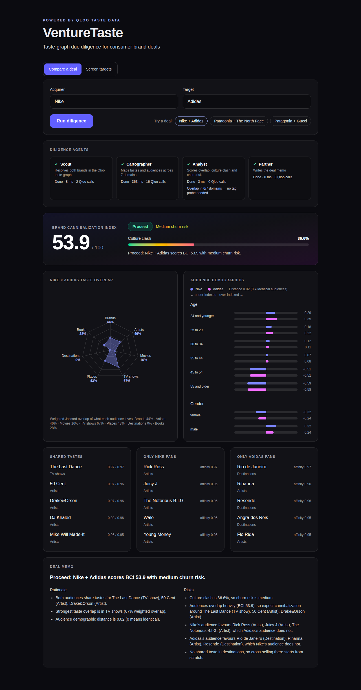
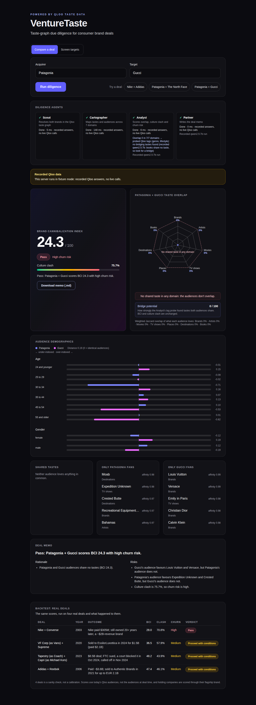
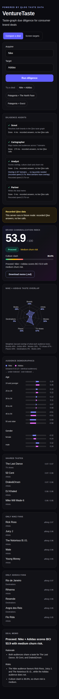

# VentureTaste

An autonomous 4-agent M&A and venture diligence pipeline for consumer brand acquisitions. Give it an acquirer and a target; it pulls both brands' taste profiles from Qloo's cross-domain taste graph and deterministically scores brand synergy, customer overlap (cannibalization) and cultural churn risk, then writes a deal memo with a verdict.

Built for the [Qloo Agentic Hackathon](https://qloo.devpost.com/). Submissions close 2026-10-30.



Stack: Python, FastAPI, LangGraph, Pydantic, Qloo Taste AI API, Next.js (static export), Tailwind, Recharts. No LLM is involved: every number and every sentence of the memo comes from Qloo data and fixed formulas, so a run is reproducible.

## Why it needs Qloo

The pipeline is built on Qloo's cross-domain taste graph. A brand maps to the things its audience loves in seven domains (brand, artist, movie, tv_show, place, destination, book) plus its age and gender skew. Comparing two brands across those domains is what makes "do these customers overlap, or clash?" answerable. Without Qloo there is no data to compare.

Endpoints used (`api/qloo.py`, header `X-Api-Key`):

- `GET /search` with `query=<brand>` and `types=urn:entity:brand` resolves a brand name to a Qloo entity.
- `GET /v2/insights` with `filter.type=urn:entity:<domain>`, `signal.interests.entities=<entity id>` and `take=50` (the most Qloo allows) returns the entities with the highest affinity for that brand, one call per domain.
- `GET /v2/insights` with `filter.type=urn:demographics` and `signal.interests.entities=<entity id>` returns the brand's age and gender affinities.

Responses are cached on disk (`.cache/qloo`), and HTTP 429 is retried with backoff.

## The four agents

`api/pipeline.py` runs them as a LangGraph `StateGraph`. Each agent records its name, status, duration and Qloo call count in a `trace`.

1. **Scout** resolves both brand names to Qloo entities (2 calls).
2. **Cartographer** fetches insights for all 7 domains plus demographics for both brands (16 calls, in parallel threads). 18 Qloo calls per run with the two searches.
3. **Analyst** scores the pair with `api/scoring.py` (pure code, no calls).
4. **Partner** writes the deal memo from templates: a verdict (`Proceed`, `Proceed with conditions`, `Pass`), rationale and risks that name real Qloo entities from the data.

## API

`POST /api/diligence` runs the pipeline and returns one JSON report: resolved brands, scores, `domain_overlap` for all 7 domains (no data = 0), top shared and clashing tastes, demographics for both brands, the memo, and the per-agent `trace`.

```
curl -s -X POST http://127.0.0.1:8765/api/diligence \
  -H 'Content-Type: application/json' \
  -d '{"acquirer": "Nike", "target": "Adidas"}'
```

Errors are `{"detail": "..."}` with: 422 for a bad body, an unknown brand, a brand with no taste data, or the same brand twice; 503 when `QLOO_API_KEY` is missing; 502 when Qloo fails or returns something unparseable.

`POST /api/diligence/stream` takes the same body and returns server-sent events (`text/event-stream`, with `Cache-Control: no-cache` and `X-Accel-Buffering: no`):

- `event: agent` with `{"agent": "Scout", "status": "running"}` when an agent starts, and `{"agent": "Scout", "status": "ok", "ms": 4, "qloo_calls": 2}` when it finishes. Agents come in order: Scout, Cartographer, Analyst, Partner.
- `event: result` with the same report `POST /api/diligence` returns. It is the last event of a good run.
- `event: error` with `{"status": 422, "detail": "..."}` if the run fails after the stream has started. The HTTP status is already 200 by then, so read `status` from the payload. A missing key (503) or a bad body (422) still fails before streaming, as a plain JSON error.

```
curl -N -X POST http://127.0.0.1:8765/api/diligence/stream \
  -H 'Content-Type: application/json' \
  -d '{"acquirer": "Nike", "target": "Adidas"}'
```

`GET /api/presets` lists the demo pairs (`id`, `label`, `acquirer`, `target`, `kind`). `GET /api/health` returns `{"ok": true}`.

## Scoring

`api/scoring.py` is pure (no I/O, no LLM). `score(a, b)` compares two brand profiles:

- **Domain overlap** (0..1, per domain in brand, artist, movie, tv_show, place, destination, book): weighted Jaccard over entity ids, weight = affinity clamped at 0: `sum(min(wa, wb)) / sum(max(wa, wb))` over the union of ids. Both empty (or all weights 0) gives 0. Domains empty for both brands are left out. A domain with entities for one brand only scores 0.
- **Mean overlap**: mean of the domain overlaps (0 if there are none).
- **Demographic distance** (0..1): over the union of age and gender keys (missing = 0), `mean(|a - b|) / 2`, clamped.
- **BCI** (0..100): `100 * (0.7 * mean_overlap + 0.3 * (1 - demographic_distance))`.
- **Culture Clash %** (0..100): `100 * (0.7 * (1 - mean_overlap) + 0.3 * demographic_distance)`.
- **Culture Clash** is always `100 - BCI`, up to rounding.
- **Churn-risk band**: from Culture Clash, below 33 is `low`, below 66 is `medium`, otherwise `high`.
- **Top shared tastes**: entities in both lists of a domain, ranked by the lower of the two affinities, top 5. **Top clashing tastes**: entities with positive affinity for one brand and absent from the other's list, ranked by affinity, top 5 per brand.

Rounding: BCI and Culture Clash to 1 decimal, everything else to 4.

The verdict is `Pass` when churn risk is high, otherwise `Proceed` at BCI 50 or more, otherwise `Proceed with conditions`.

## Demo pairs

Verified live at `take=50` (`api/presets.py`):

| Pair | BCI | Culture Clash | Verdict |
| --- | --- | --- | --- |
| Nike + Adidas | 53.9 | 46.1 | Proceed (medium churn risk) |
| Patagonia + The North Face | 46.6 | 53.4 | Proceed with conditions |
| Patagonia + Gucci | 24.3 | 75.7 | Pass (high churn risk, no shared taste) |

Patagonia + Gucci: Qloo finds no entity both audiences love in any of the seven domains.





## How to run

Needs [bun](https://bun.sh), [uv](https://docs.astral.sh/uv/) and Python 3.12, plus a Qloo hackathon API key.

```
cp .env.example .env                            # then put your key in QLOO_API_KEY
bun run setup                                   # uv sync + bun install in web/
(cd web && bunx playwright install chromium)    # once, for e2e and screenshots
bun run build                                   # static export to web/out
bun run start                                   # FastAPI serves API and web on http://127.0.0.1:8765
```

`bun run start` reads `.env`; `QLOO_API_URL` defaults to `https://hackathon.api.qloo.com`.

Dev mode: `bun run dev` starts the API with reload on :8765 and `next dev` for the UI.

**Fixture mode:** with `VENTURETASTE_FIXTURES=1` the API answers from recorded Qloo responses, with no key and no network. The e2e tests use it. Do not use it in production.

## Deploy

```
docker build -t venturetaste .
docker run -d -p 8765:8765 --env-file .env venturetaste    # http://127.0.0.1:8765
```

The image builds the web app, installs the API with uv and runs uvicorn as a non-root user with `--proxy-headers`. Never set `VENTURETASTE_FIXTURES` in production.

| Variable | Default | What it does |
| --- | --- | --- |
| `QLOO_API_KEY` | none, required | Qloo hackathon API key |
| `QLOO_API_URL` | `https://hackathon.api.qloo.com` | Qloo base URL |
| `VENTURETASTE_RATE_LIMIT` | `30` | diligence runs per client IP per 60 s, over it the API answers 429 with `Retry-After` |
| `VENTURETASTE_CACHE_MAX_FILES` | `2000` | most files kept in `.cache/qloo`, the oldest are deleted first |
| `FORWARDED_ALLOW_IPS` | `127.0.0.1,10.0.0.0/8,172.16.0.0/12,192.168.0.0/16` (in the image) | proxies uvicorn trusts for `X-Forwarded-For`, CIDR ranges allowed. The default covers a Docker network proxy such as Traefik on Coolify, so the rate limit is per visitor. Never `*`: a client could then spoof its IP to dodge the limit |

The rate limit is in memory and per process. The SSE stream sends `X-Accel-Buffering: no`, so nginx style proxies do not buffer it.

`bun run docker:smoke` builds the image, runs it on port 8799 with your `.env`, waits for `/api/health`, runs the Playwright spec `web/e2e/live.spec.ts` (Nike + Adidas against real Qloo) and removes the container. Set `BASE_URL` and run `cd web && bunx playwright test` to run that spec against any other deployment.

## How to test

- `bun run test`: pytest over `api/tests` (offline).
- `bun run test:live`: the live-marked tests against the real Qloo API (needs `QLOO_API_KEY` in `.env`).
- `bun run typecheck`: `tsc` for the web app and `mypy` for the API.
- `bun run e2e:ci`: builds the web app, then runs the Playwright tests against FastAPI in fixture mode. `bun run e2e` is the same but reuses a server already running on :8765.
- `bun run screenshots`: rebuilds and regenerates the images in `docs/`.
- `bun run fresh-clone`: clones the committed HEAD into a temp dir and runs setup, test, typecheck and e2e:ci there, as a new user would. Needs no key.
- `bun run record`: re-records the fixtures for the preset brands (needs a key).
- `bun run probe`: scores candidate pairs live (needs a key).

## Layout

```
api/main.py            FastAPI app, error mapping, SSE stream, static web mount
api/pipeline.py        the four agents as a LangGraph StateGraph, deal memo templates
api/qloo.py            typed Qloo client: search, insights, demographics, cache, retries
api/scoring.py         pure scoring
api/presets.py         demo pairs
api/record_fixtures.py records Qloo responses for fixture mode
api/probe.py           scores candidate pairs live
api/tests/             pytest suite and the fixture-backed fake Qloo
web/                   Next.js app (static export to web/out), Playwright tests in web/e2e
docs/                  README screenshots
scripts/fresh-clone.sh fresh-clone check
```

## License

MIT, see LICENSE.
